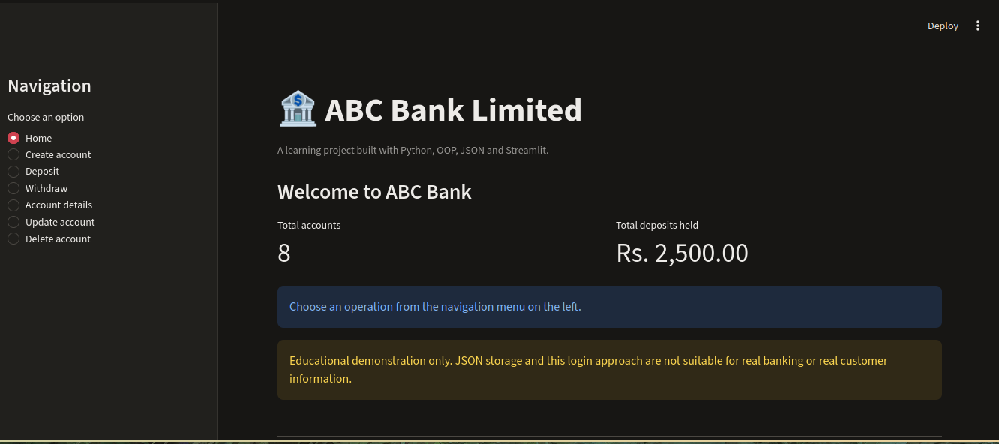

# 🏦 ABC Bank Management System

A beginner-friendly banking management application built with **Python, Object-Oriented Programming (OOP), JSON, and Streamlit**. It provides a browser-based interface for practising account management and basic banking operations.

> **Educational project only:** This application is a learning demonstration. It is not designed for real banking, real money, or real customer information.

## 📸 Application Preview



*ABC Bank home dashboard running locally with Streamlit.*

## ✨ Features

- Create an account with basic customer details
- Deposit and withdraw money with balance validation
- View account details after account verification
- Update account information, including the PIN
- Delete an account when its balance is zero
- View transaction history
- Validate inputs and handle common errors
- Hash account PINs instead of storing them as plain text

## 🧰 Built With

- **Python** — application logic
- **Streamlit** — browser-based user interface
- **Pandas** — transaction-history table
- **JSON** — local demo data storage
- **Git and GitHub** — version control and project hosting

## 📁 Project Structure

```text
BANK-MANAGEMENT/
├── app.py              # Streamlit user interface
├── bank.py             # Banking logic and Bank class
├── requirements.txt    # Python dependencies
├── README.md           # Project documentation
└── assets/
    └── dashboard.png   # Application screenshot
```

The application creates `data.json` locally when account data is saved. Keep this file out of the public repository because it may contain account information.

## 🚀 Getting Started

### 1. Clone the repository

```bash
git clone https://github.com/asadullahkhan1122433-cell/BANK-MANAGEMENT.git
cd BANK-MANAGEMENT
```

### 2. Create a virtual environment

```bash
python -m venv .venv
```

### 3. Activate the virtual environment

**Fish shell (Arch Linux):**

```fish
source .venv/bin/activate.fish
```

**Bash:**

```bash
source .venv/bin/activate
```

### 4. Install dependencies

```bash
python -m pip install -r requirements.txt
```

### 5. Run the application

```bash
streamlit run app.py
```

Streamlit will provide a local URL, usually `http://localhost:8501`. Open it in your browser.

## 🧠 What I Practised

- Python classes, objects, methods, and OOP structure
- Functions, conditionals, loops, lists, and dictionaries
- Reading and writing JSON data
- Exception handling and input validation
- Separating application logic from the user interface
- Building an interactive web app with Streamlit
- Using Git and GitHub to manage and share a project

## 🔒 Security & Limitations

This is **not production banking software**. It uses a local JSON file and is intended for learning and experimentation only. PIN hashing is included as a learning measure, but it does not make the application suitable for real financial use.

A real banking system would require a properly secured database, robust authentication and authorization, secure deployment, audit logging, backups, concurrency controls, and professional security testing.

**Please do not enter real personal, account, or financial information.**

## 🔗 Repository

[View ABC Bank Management System on GitHub](https://github.com/asadullahkhan1122433-cell/BANK-MANAGEMENT)
